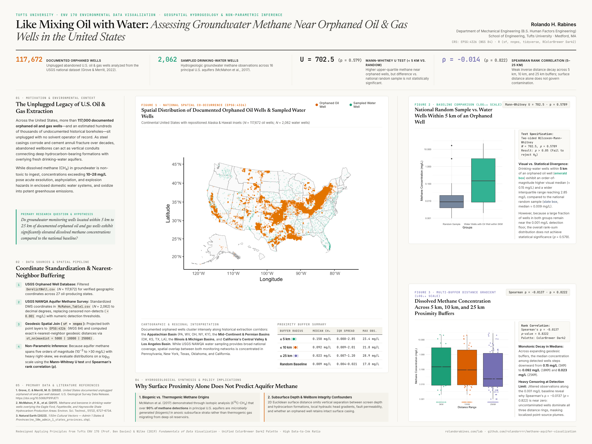

# Like Mixing Oil with Water: Assessing Groundwater Methane Near Orphaned Oil & Gas Wells in the United States

**Author:** Rolando H. Rabines (Tufts University, B.S. Human Factors Engineering)  
**Interactive Quarto / R Report:** [View Live HTML Report](https://rolandorrrr.github.io/methane-aquifer-visualization/) · [rolandorabines.com/lab](https://rolandorabines.com/lab/)  
**Redesigned Research Poster (48×36 PDF):** [`48x36_Rabines_Rolando_Project_Poster_v2.pdf`](./48x36_Rabines_Rolando_Project_Poster_v2.pdf) · [Original 2024 Poster PDF](./48x36_Rabines_Rolando_Project_Poster.pdf)

---

## Overview

Across the United States, more than **117,672 documented unplugged orphaned oil and gas wells** sit abandoned with no solvent operator of record. As steel casings corrode and cement annuli fracture over decades, abandoned wellbores can act as vertical conduits connecting deep hydrocarbon-bearing formations with overlying fresh drinking-water aquifers.

This environmental data visualization and spatial statistical study investigates whether groundwater monitoring wells located within **5 km, 10 km, and 25 km** of documented orphaned oil and gas wells exhibit significantly elevated dissolved methane ($\text{CH}_4$) concentrations compared to the national baseline.

### Empirical Summary

| Metric / Test | Value | Dataset / Specification |
| :--- | :--- | :--- |
| **Documented Orphaned Oil & Gas Wells** | `N = 117,672` | USGS National Unplugged Orphaned Well Dataset (Grove & Merrill, 2022) |
| **Sampled Drinking-Water Wells** | `N = 2,062` | USGS NAWQA Principal Aquifer Methane Survey (McMahon et al., 2017) |
| **Mann–Whitney U Test (`≤ 5 km` vs. Random)** | `U = 702.5, p = 0.5789` | Higher visual median (`0.150 mg/L` vs. `0.009 mg/L`) and wider IQR (`0.008–2.85 mg/L`) within 5 km, but not statistically significant due to heavy non-detect censoring at `0.001 mg/L` |
| **Spearman Rank Correlation (`5–25 km`)** | `ρ = -0.0137, p = 0.8222` | Monotonic decrease in detected medians (`0.150` → `0.092` → `0.023 mg/L`), but surface Euclidean distance alone does not govern subsurface methane migration |

---

## Key Methods & Stack

- **Languages & Packages:** R (`tidyverse`, `ggplot2`, `sf`, `nngeo`, `tigris`, `RColorBrewer`), Quarto (`.qmd` → HTML5).
- **Geodesic Spatial Pipeline (`EPSG:4326`):** Standardized degrees-minutes-seconds (DMS) coordinates into WGS 84 decimal degrees, repositioned Alaska and Hawaii insets via `tigris::shift_geometry()`, and computed k-nearest-neighbor geodesic buffers (`st_nn()`) across `5,000 m`, `10,000 m`, and `25,000 m` radii.
- **Visual Design Principles (Redesigned v2 Poster):**
  - High data-to-ink editorial typography (`Newsreader`, `Inter`, `JetBrains Mono`) with zero decorative chartjunk.
  - Unified colorblind-safe **ColorBrewer `Dark2`** palette (`#D95F02` burnt orange, `#1B9E77` emerald-teal, `#7570B3` purple) across all spatial and statistical figures so the `≤ 5 km` buffer group shares the exact same `#1B9E77` visual encoding across Figures 2 and 3.
  - Removed redundant right-hand legends that duplicated direct x-axis labels, and paired figures with structured margin captions (`cap-location: margin`).

---

## Repository Contents

- [`48x36_Rabines_Rolando_Project_Poster_v2.pdf`](./48x36_Rabines_Rolando_Project_Poster_v2.pdf) — Redesigned 48×36 academic research poster (PDF).
- [`poster-v2-preview.png`](./poster-v2-preview.png) — High-resolution PNG render of the redesigned 48×36 research poster.
- [`poster_v2/`](./poster_v2/) — HTML/CSS poster layout source (`poster_v2.html`) and unified `Dark2` figure exports (`fig1_map.png`, `fig2_comparison.png`, `fig3_buffers.png`).
- [`index.html`](./index.html) / [`Rabines_Rolando_FinalProjectV47.html`](./Rabines_Rolando_FinalProjectV47.html) — Compiled interactive Quarto HTML report with code blocks, statistical outputs, and `ggplot2` visualizations.
- [`Rabines_Rolando_FinalProject.qmd`](./Rabines_Rolando_FinalProject.qmd) — Quarto source notebook.
- [`analysis.R`](./analysis.R) — Standalone R spatial & statistical script.
- [`48x36_Rabines_Rolando_Project_Poster.pdf`](./48x36_Rabines_Rolando_Project_Poster.pdf) — Original 2024 48×36 research poster (archived for comparison).

---

## References

1. **Grove, C. & Merrill, M. D. (2022).** *United States documented unplugged orphaned oil and gas well dataset.* U.S. Geological Survey Data Release. https://doi.org/10.5066/P91PJETI
2. **McMahon, P. B., et al. (2017).** *Methane and benzene in drinking-water wells overlying the Eagle Ford, Fayetteville, and Haynesville Shale Hydrocarbon Production Areas.* Environmental Science & Technology, 51(12), 6727–6734.
3. **Wilke, C. O. (2019).** *Fundamentals of Data Visualization: A Primer on Making Informative and Compelling Figures.* O'Reilly Media.
